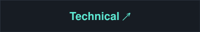

 

<a href="#about">About</a> &nbsp;·&nbsp;
<a href="#experience">Experience</a> &nbsp;·&nbsp;
<a href="#stack">Tech Stack</a> &nbsp;·&nbsp;
<a href="#projects">Projects</a> &nbsp;·&nbsp;
<a href="#education">Education</a> &nbsp;·&nbsp;
<a href="#contact">Contact</a>

 

I'm **Hany**, a Flutter Developer who builds mobile applications that combine clean architecture, practical functionality, and thoughtful user experiences. I focus on writing maintainable code and delivering reliable, user-focused apps.

 

### Flutter Developer &nbsp;·&nbsp; American Soft
**2026 — Present**

Building and maintaining a multi-flavor Flutter dashboard suite (Admin, Technical, and Center) for orders, finance, and operations.

- Develop and maintain dashboard applications with separate **Admin**, **Technical**, and **Center** flavors
- Build modules for orders, employees, centers, products, brands, invoices, treasury, wallets, and financial reports
- Integrate REST APIs with **Dio**, organizing logic with **Cubit**, repositories, and **GetIt** dependency injection
- Implement role-based access, secure token handling, pagination, filtering, order status updates, and centralized error handling
- Integrate **Firebase Cloud Messaging**, biometric authentication, PDF reporting, and **Google ML Kit** language identification and translation
- Use **Shorebird Patch** for eligible over-the-air Flutter updates

### Freelance Flutter Developer
Al Reef Water and Twins Gomla Market, built end to end and published on Google Play (see Projects below).

 

 

 

 

 

 

<table>
<tr>
<td width="50%" valign="top">

**🎓 B.Sc. in Computer Science** 
Thebes Academy · 2021 — 2025

</td>
<td width="50%" valign="top">

**🌐 Languages** 
Arabic — Native 
English — Professional Working Proficiency

</td>
</tr>
</table>

 

  

 
 
 
 

 

