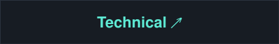
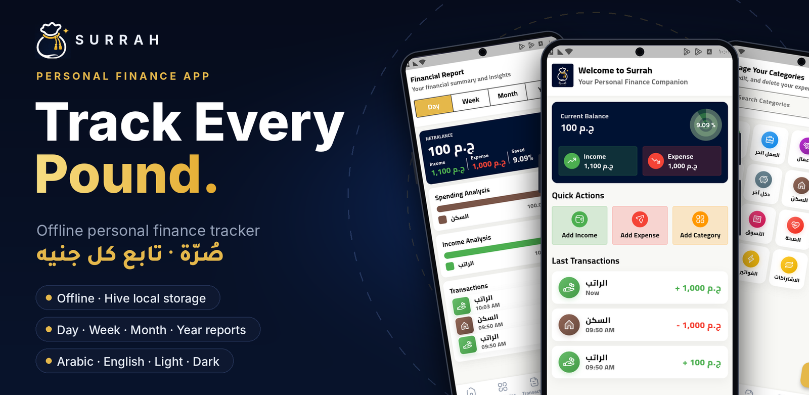
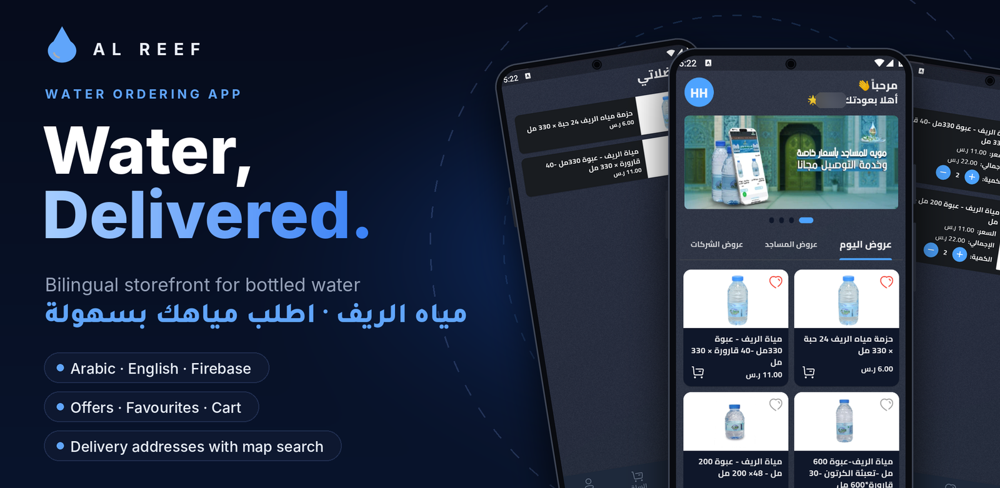
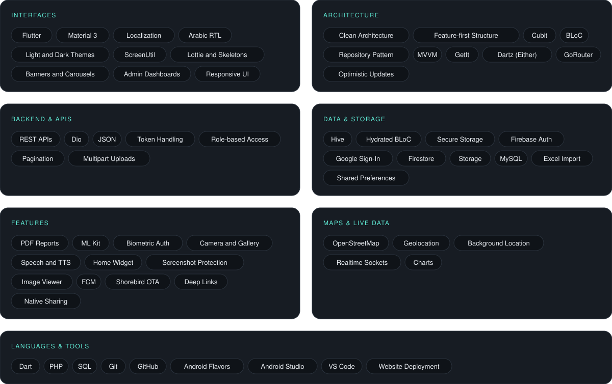

 

<a href="#experience">Experience</a> &nbsp;·&nbsp;
<a href="#projects">Projects</a> &nbsp;·&nbsp;
<a href="#skills">Skills</a> &nbsp;·&nbsp;
<a href="#contact">Contact</a>

 

### Flutter Developer &nbsp;·&nbsp; American Soft
**2026 — Present**

Dashboards with separate Admin, Technical, and Center flavors.

- Modules for orders, employees, centers, products, brands, invoices, treasury, wallets, and financial reports
- REST integration with **Dio**, **Cubit** and repositories, **GetIt** dependency injection
- Role-based access, secure token handling, pagination, filtering, and centralized error handling
- **Firebase Cloud Messaging**, biometric authentication, PDF reporting, **Google ML Kit** translation, **Shorebird** OTA patches

`Cubit` `Dio` `GetIt` `FCM` `ML Kit` `Shorebird`

### Freelance Flutter Developer
**4 projects** — customer, admin, marketplace, and Forex projects.

- **Al Reef Water:** bilingual customer storefront with offers, favourites, cart, addresses, and orders
- **Al Reef Dashboard:** admin app for banners, product offers, and incoming orders
- **StbtrFx Economic Calendar:** Forex app feature with filters, notification toggles, and shareable event links
- **Twins Gomla Market:** Excel bulk import, automatic categories, and duplicate prevention

`Firestore` `Storage` `Batch writes` `REST APIs`

### B.Sc. in Computer Science &nbsp;·&nbsp; Thebes Academy
**2021 — 2025** &nbsp;·&nbsp; Arabic (Native) · English (Professional)

 

Six projects: a company dashboard suite, a personal app and four freelance projects.

Internal operations dashboard for appliance maintenance: requests, dispatch, centers, technicians and service finances, shipped as three Android apps. `Cubit` `Dio` `GetIt` `Flavors`

  

Local personal finance tracker: income and expenses, custom categories, a balance dashboard and period reports. Arabic and English, stored on the device with Hive. `Cubit` `Hive` `Hydrated BLoC` <a href="https://github.com/Hany-Hagar/surrah-app">GitHub</a> &nbsp;·&nbsp; <a href="https://play.google.com/store/apps/details?id=com.surrah.app">Google Play</a>

  

Bilingual water storefront: three offer categories, favourites, cart, delivery addresses with map search and order history, backed by Firebase. `Firestore` `Firebase Auth` `Cubit` <a href="https://play.google.com/store/apps/details?id=com.code_plus.al_reef_water">Google Play</a>

  

Admin app for the Al Reef store: promotional banners, product offers by audience, and incoming delivery orders with status badges. `Firestore` `Cubit` `Admin`

  

Excel bulk product import with automatic category creation and duplicate prevention, using Firestore batch writes and parallel image handling. `Firestore` `Storage` <a href="https://play.google.com/store/apps/details?id=com.orderappcomany.orderapp">Google Play</a>

  

Bilingual economic calendar inside the StbtrFx Forex app: paginated events, period, impact and country filters, notification toggles and shareable event links. `Cubit` `Dio` `GoRouter` `Share links` <a href="https://play.google.com/store/apps/details?id=com.code_plus.stbtrfx">Google Play</a>

 

 

  

 
 
 
 

 

