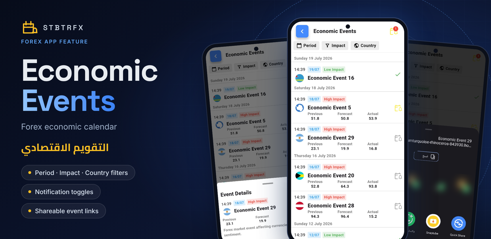

  Six projects covering company products, personal applications and freelance development.

 

<!-- American Soft Dashboard -->
<table width="100%" border="1" cellpadding="12" cellspacing="0">
<tr>
<td width="50%" align="center" valign="middle">
  
</td>
<td width="50%" valign="middle">
  COMPANY · AMERICAN SOFT
  <h2>American Soft Dashboard</h2>
  Admin, Technical and Center flavors for appliance maintenance operations, including orders, employees, centers, products and financial reports.

    
  <code>Flutter</code> <code>Cubit</code> <code>Dio</code> <code>GetIt</code> <code>FCM</code>
</td>
</tr>
<tr>
<td colspan="2" align="center" cellpadding="0">
  <table width="100%">
    <tr>
      <td width="33%" align="center">
        <a href="https://play.google.com/store/apps/details?id=com.americangroup.dashboardAdmin"><b>Admin ↗</b></a>
      </td>
      <td width="33%" align="center">
        <a href="https://play.google.com/store/apps/details?id=com.americangroup.dashboard"><b>Technical ↗</b></a>
      </td>
      <td width="33%" align="center">
        <a href="https://play.google.com/store/apps/details?id=com.americangroup.dashboardCenter"><b>Center ↗</b></a>
      </td>
    </tr>
  </table>
</td>
</tr>
</table>

 

<!-- Surrah -->
<table width="100%" border="1" cellpadding="12" cellspacing="0">
<tr>
<td width="50%" align="center" valign="middle">
  
</td>
<td width="50%" valign="middle">
  PERSONAL PROJECT
  <h2>Surrah · صُرّة</h2>
  Offline personal finance application for tracking income, expenses, custom categories, balance and daily, weekly and monthly reports. Supports Arabic and English.

    
  <code>Flutter</code> <code>Cubit</code> <code>Hive</code> <code>Hydrated BLoC</code>
</td>
</tr>
<tr>
<td colspan="2" align="center">
  <table width="100%">
    <tr>
      <td width="50%" align="center">
        <a href="https://github.com/Hany-Hagar/surrah-app"><b>GitHub ↗</b></a>
      </td>
      <td width="50%" align="center">
        <a href="https://play.google.com/store/apps/details?id=com.surrah.app"><b>Google Play ↗</b></a>
      </td>
    </tr>
  </table>
</td>
</tr>
</table>

 

<!-- Al Reef Water -->
<table width="100%" border="1" cellpadding="12" cellspacing="0">
<tr>
<td width="50%" align="center" valign="middle">
  
</td>
<td width="50%" valign="middle">
  FREELANCE · CUSTOMER APP
  <h2>Al Reef Water</h2>
  Bilingual water ordering application featuring offers, favourites, shopping cart, delivery addresses with map search and order history.

    
  <code>Flutter</code> <code>Cubit</code> <code>Firestore</code> <code>Firebase Auth</code>
</td>
</tr>
<tr>
<td colspan="2" align="center">
  <table width="100%">
    <tr>
      <td width="100%" align="center">
        <a href="https://play.google.com/store/apps/details?id=com.code_plus.al_reef_water"><b>Google Play ↗</b></a>
      </td>
    </tr>
  </table>
</td>
</tr>
</table>

 

<!-- Al Reef Dashboard -->
<table width="100%" border="1" cellpadding="12" cellspacing="0">
<tr>
<td width="50%" align="center" valign="middle">
  
</td>
<td width="50%" valign="middle">
  FREELANCE · ADMIN APP
  <h2>Al Reef Dashboard</h2>
  Administration application for managing promotional banners, product offers by audience and incoming delivery orders with order status tracking.

    
  <code>Flutter</code> <code>Cubit</code> <code>Firestore</code> <code>Firebase</code>
</td>
</tr>
</table>

 

<!-- Twins Gomla Market -->
<table width="100%" border="1" cellpadding="12" cellspacing="0">
<tr>
<td width="50%" align="center" valign="middle">
  
</td>
<td width="50%" valign="middle">
  FREELANCE · MARKETPLACE
  <h2>Twins Gomla Market</h2>
  Marketplace application with bulk Excel product imports, automatic category creation, duplicate prevention and parallel image handling.

    
  <code>Flutter</code> <code>Firestore</code> <code>Firebase Storage</code> <code>Batch Writes</code>
</td>
</tr>
<tr>
<td colspan="2" align="center">
  <table width="100%">
    <tr>
      <td width="100%" align="center">
        <a href="https://play.google.com/store/apps/details?id=com.orderappcomany.orderapp"><b>Google Play ↗</b></a>
      </td>
    </tr>
  </table>
</td>
</tr>
</table>

 

<!-- StbtrFx -->
<table width="100%" border="1" cellpadding="12" cellspacing="0">
<tr>
<td width="50%" align="center" valign="middle">
  
</td>
<td width="50%" valign="middle">
  FREELANCE · FOREX FEATURE
  <h2>StbtrFx Economic Calendar</h2>
  Bilingual economic calendar featuring paginated events, period, impact and country filters, notification toggles and shareable event links.

    
  <code>Flutter</code> <code>Cubit</code> <code>Dio</code> <code>GoRouter</code>
</td>
</tr>
<tr>
<td colspan="2" align="center">
  <table width="100%">
    <tr>
      <td width="100%" align="center">
        <a href="https://play.google.com/store/apps/details?id=com.code_plus.stbtrfx"><b>Google Play ↗</b></a>
      </td>
    </tr>
  </table>
</td>
</tr>
</table>

