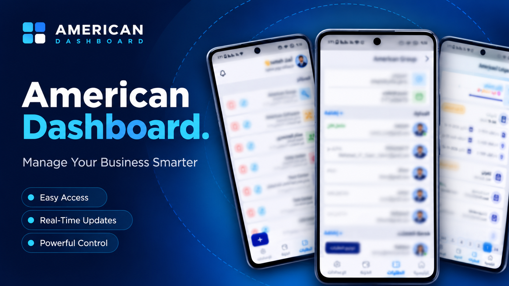
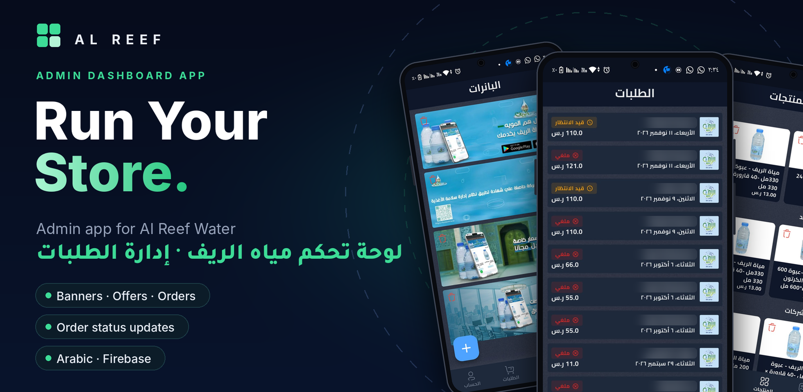
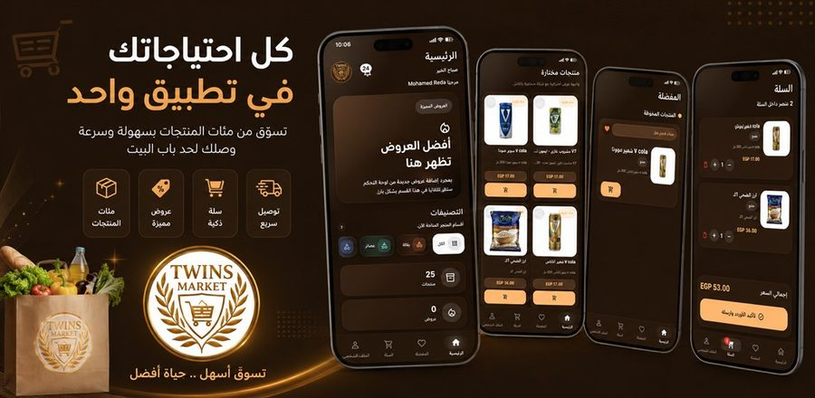

عاوزك تعدل الكود ده 

 

<a href="#experience">Experience</a> &nbsp;·&nbsp;
<a href="#projects">Projects</a> &nbsp;·&nbsp;
<a href="#skills">Skills</a> &nbsp;·&nbsp;
<a href="#contact">Contact</a>

 

### Flutter Developer &nbsp;·&nbsp; American Soft
**2026 — Present**

Dashboards with separate Admin, Technical, and Center flavors.

- Modules for orders, employees, centers, products, brands, invoices, treasury, wallets, and financial reports
- REST integration with **Dio**, **Cubit** and repositories, **GetIt** dependency injection
- Role-based access, secure token handling, pagination, filtering, and centralized error handling
- **Firebase Cloud Messaging**, biometric authentication, PDF reporting, **Google ML Kit** translation, **Shorebird** OTA patches

`Cubit` `Dio` `GetIt` `FCM` `ML Kit` `Shorebird`

### Freelance Flutter Developer
**4 projects** — customer, admin, marketplace, and Forex projects.

- **Al Reef Water:** bilingual customer storefront with offers, favourites, cart, addresses, and orders
- **Al Reef Dashboard:** admin app for banners, product offers, and incoming orders
- **StbtrFx Economic Calendar:** Forex app feature with filters, notification toggles, and shareable event links
- **Twins Gomla Market:** Excel bulk import, automatic categories, and duplicate prevention

`Firestore` `Storage` `Batch writes` `REST APIs`

### B.Sc. in Computer Science &nbsp;·&nbsp; Thebes Academy
**2021 — 2025** &nbsp;·&nbsp; Arabic (Native) · English (Professional)

 

  Six projects covering company products, personal applications and freelance development.

 

<!-- American Soft Dashboard -->
<!-- American Dashboard -->
<table width="100%" border="1" cellpadding="12" cellspacing="0">
<tr>
<td width="45%" align="center" valign="middle">
  
</td>
<td width="55%" valign="middle">
  COMPANY · AMERICAN SOFT
  <h2>American Dashboard</h2>

  Admin dashboard application for managing business operations, maintenance centers, employees, customer service, and incoming orders. Includes center management, user administration, order tracking, and financial operations.

    
  <code>Flutter</code> <code>Cubit</code> <code>Dio</code>
  <code>GetIt</code> <code>FCM</code> <code>Firebase</code>

    
  <a href="https://play.google.com/store/apps/details?id=com.americangroup.dashboardAdmin">Admin ↗</a>
  &nbsp;·&nbsp;
  <a href="https://play.google.com/store/apps/details?id=com.americangroup.dashboard">Technical ↗</a>
  &nbsp;·&nbsp;
  <a href="https://play.google.com/store/apps/details?id=com.americangroup.dashboardCenter">Center ↗</a>
</td>
</tr>
</table>

<!-- Surrah -->
<table width="100%" border="1" cellpadding="12" cellspacing="0">
<tr>
<td width="45%" align="center" valign="middle">
  
</td>
<td width="55%" valign="middle">
  PERSONAL PROJECT
  <h2>Surrah · صُرّة</h2>
  Offline personal finance application for tracking income, expenses, custom categories, balance and daily, weekly and monthly reports. Supports Arabic and English.

    
  <code>Flutter</code> <code>Cubit</code> <code>Hive</code> <code>Hydrated BLoC</code>

    
  <a href="https://github.com/Hany-Hagar/surrah-app">GitHub ↗</a>
  &nbsp;·&nbsp;
  <a href="https://play.google.com/store/apps/details?id=com.surrah.app">Google Play ↗</a>
</td>
</tr>
</table>

 

<!-- Al Reef Water -->
<table width="100%" border="1" cellpadding="12" cellspacing="0">
<tr>
<td width="45%" align="center" valign="middle">
  
</td>
<td width="55%" valign="middle">
  FREELANCE · CUSTOMER APP
  <h2>Al Reef Water</h2>
  Bilingual water ordering application featuring offers, favourites, shopping cart, delivery addresses with map search and order history.

    
  <code>Flutter</code> <code>Cubit</code> <code>Firestore</code> <code>Firebase Auth</code>

    
  <a href="https://play.google.com/store/apps/details?id=com.code_plus.al_reef_water">Google Play ↗</a>
</td>
</tr>
</table>

 

<!-- Al Reef Dashboard -->
<table width="100%" border="1" cellpadding="12" cellspacing="0">
<tr>
<td width="45%" align="center" valign="middle">
  
</td>
<td width="55%" valign="middle">
  FREELANCE · ADMIN APP
  <h2>Al Reef Dashboard</h2>
  Administration application for managing promotional banners, product offers by audience and incoming delivery orders with order status tracking.

    
  <code>Flutter</code> <code>Cubit</code> <code>Firestore</code> <code>Firebase</code>
</td>
</tr>
</table>

 

<!-- Twins Gomla Market -->
<table width="100%" border="1" cellpadding="12" cellspacing="0">
<tr>
<td width="45%" align="center" valign="middle">
  
</td>
<td width="55%" valign="middle">
  FREELANCE · MARKETPLACE
  <h2>Twins Gomla Market</h2>
  Marketplace application with bulk Excel product imports, automatic category creation, duplicate prevention and parallel image handling.

    
  <code>Flutter</code> <code>Firestore</code> <code>Firebase Storage</code> <code>Batch Writes</code>

    
  <a href="https://play.google.com/store/apps/details?id=com.orderappcomany.orderapp">Google Play ↗</a>
</td>
</tr>
</table>

 

<!-- StbtrFx -->
<table width="100%" border="1" cellpadding="12" cellspacing="0">
<tr>
<td width="45%" align="center" valign="middle">
  
</td>
<td width="55%" valign="middle">
  FREELANCE · FOREX FEATURE
  <h2>StbtrFx Economic Calendar</h2>
  Bilingual economic calendar featuring paginated events, period, impact and country filters, notification toggles and shareable event links.

    
  <code>Flutter</code> <code>Cubit</code> <code>Dio</code> <code>GoRouter</code>

    
  <a href="https://play.google.com/store/apps/details?id=com.code_plus.stbtrfx">Google Play ↗</a>
</td>
</tr>
</table>

 

  

 
 
 
 

 

